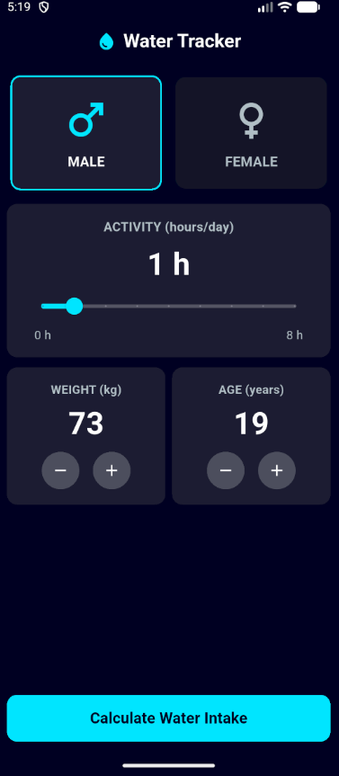
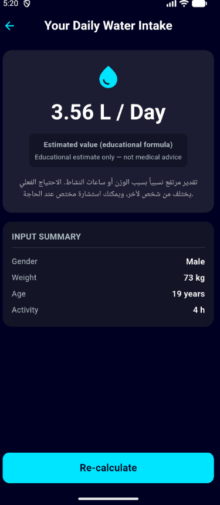

# Daily Water & Hydration Tracker App 💧

تطبيق **Daily Water & Hydration Tracker** هو تطبيق Flutter تفاعلي وأنيق يساعد المستخدم على حساب احتياجه اليومي التقديري من الماء بناءً على بياناته الأساسية (الجنس، ساعات النشاط الرياضي، الوزن، العمر)، مع تقديم إرشادات توعوية بسيطة وتصميم داكن (Dark Theme) عصري يعتمد على درجات الأزرق والسمائي.

---

## 📸 لقطات الشاشة (Screenshots)

| Input Screen (شاشة الإدخال) | Result Screen (شاشة النتيجة) |
|:---:|:---:|
|  |  |

---

## 📱 مميزات التطبيق (Features)

1. **الشاشة الأولى (Input Screen)**:
   - **Gender Selection**: بطاقتان لاختيار الجنس (`Male` و `Female`) مع تمييز البطاقة المحددة بلون نشط وإطار سمائي مضيء، ومنع تحديد الخيارين في نفس الوقت.
   - **Activity Slider**: شريط تمرير لتحديد عدد ساعات النشاط البدني اليومي من 0 إلى 8 ساعات مع عرض القيمة الحالية.
   - **Weight Card**: بطاقة للوزن بالكيلوجرام مع زري (+) و (-) دائريين، مع منع تجاوز الحدين (30 إلى 200 كجم).
   - **Age Card**: بطاقة للعمر بالسنوات مع زري (+) و (-) دائريين، مع منع تجاوز الحدين (10 إلى 100 سنة).
   - **Input Validation**: التحقق من تحديد الجنس قبل الحساب، وعرض تنبيه (`SnackBar`) في حال عدم الاختيار.
   - **Calculate Button**: زر عريض أسفل الشاشة لحساب الاحتياج والانتقال لشاشة النتيجة عبر `Navigator.push`.

2. **الشاشة الثانية (Result Screen)**:
   - **بطاقة النتيجة المركزية**: عرض النتيجة باللتر يومياً (`L / Day`) بدقة رقمين عشريين وأيقونة ماء مميزة.
   - **توضيح التقدير (Disclaimer)**: تنبيه يوضح أن القيمة تقديرية لأغراض تعليمية وليست توصية طبية.
   - **نص توجيهي**: نص مبسط يتغير ديناميكياً حسب كمية الماء المحسوبة (منخفض، متوسط، مرتفع).
   - **ملخص المدخلات (Input Summary)**: عرض منظم للوزن، العمر، وساعات النشاط، والجنس.
   - **Re-calculate Button**: زر للعودة إلى الشاشة الأولى باستخدام `Navigator.pop()`.

---

## 📐 المنطق البرمجي والمعادلة الحسابية

تم تنفيذ الحساب داخل دالة مستقلة `calculateWaterLitres` في ملف `water_calculator.dart` وفقاً للمعادلة:

```dart
baseMl = weightKg * 35;              // الاحتياج الأساسي
activityMl = activityHours * 250;    // الزيادة بسبب النشاط
totalMl = baseMl + activityMl;       // المجموع بالمليلتر
litres = totalMl / 1000;             // التحويل إلى لتر
```

### حالات اختبار الدالة (Test Cases):
| الوزن (kg) | ساعات النشاط (h) | الحساب بالمليلتر | النتيجة (L / Day) |
|:---:|:---:|:---:|:---:|
| 50 | 0 | 1750 + 0 = 1750 | **1.75** |
| 60 | 8 | 2100 + 2000 = 4100 | **4.10** |
| 70 | 2 | 2450 + 500 = 2950 | **2.95** |
| 90 | 4 | 3150 + 1000 = 4150 | **4.15** |

---

## 🎨 لوحة الألوان (Color Palette)

| العنصر | اللون | الكود |
|:---|:---:|:---|
| خلفية التطبيق (Background) | ⬛ | `#0A0E21` |
| البطاقة النشطة (Active Card) | 🟦 | `#1D1E33` |
| البطاقة غير النشطة (Inactive Card) | ⬛ | `#111328` |
| لون الماء الأساسي (Primary Accent) | 🔷 | `#00E5FF` |
| النص الرئيسي (Primary Text) | ⬜ | `#FFFFFF` |
| النص الثانوي (Secondary Text) | 🔘 | `#B0BEC5` |

---

## 🧩 الـ Widgets المستخدمة في التطبيق

- **MaterialApp**: تهيئة التطبيق وتحديد الشاشة الأولى والثيم العام الداكن.
- **Scaffold**: الهيكل الأساسي للشاشات (`AppBar`, `body`, خلفية الشاشة).
- **AppBar**: شريط العنوان العلوي وأيقونة الماء وزر الرجوع.
- **SafeArea**: لحماية الواجهة من حواف الشاشة والنوتش.
- **SingleChildScrollView**: لتجنب مشكلة الـ `RenderFlex overflow` وضمان التمرير السلس.
- **Column & Row**: تنظيم العناصر رأسياً وأفقياً.
- **Expanded & Flexible**: توزيع المساحات بنسب متناسقة ومرنة.
- **Container**: تصميم البطاقات وتلوينها والحواف الدائرية (`BorderRadius`).
- **GestureDetector**: التقاط اللمس عند اختيار بطاقات الجنس.
- **Slider & SliderTheme**: تخصيص شريط سحب ساعات النشاط.
- **RawMaterialButton**: تصميم أزرار (+) و (-) الدائرية.
- **ElevatedButton**: الأزرار العريضة أسفل الشاشتين.
- **SnackBar**: إظهار رسالة التنبيه عند عدم اختيار الجنس.
- **Navigator**: التنقل وتمرير البيانات بين الشاشات (`push` و `pop`).

---

## 📂 الهيكلية البرمجية (Project Architecture)

```text
lib/
├── screens/
│   ├── input_screen.dart       # الشاشة الأولى لإدخال البيانات
│   └── result_screen.dart      # شاشة عرض النتيجة والإرشادات
├── utils/
│   └── water_calculator.dart   # دالة الحساب المستقلة
├── widgets/
│   ├── gender_card.dart        # بطاقة اختيار الجنس
│   ├── counter_card.dart       # بطاقة أزرار الوزن والعمر
│   └── bottom_button.dart      # الزر السفلي العريض
└── main.dart                   # نقطة الانطلاق وإعداد الثيم والألوان
```

---

## 🚀 طريقة تشغيل المشروع (How to Run)

1. التأكد من تحميل الاعتماديات:
   ```bash
   flutter pub get
   ```
2. تشغيل اختبارات الوحدة للتأكد من صحة الحسابات:
   ```bash
   flutter test
   ```
3. تشغيل التطبيق على الهاتف أو المحاكي:
   ```bash
   flutter run
   ```
